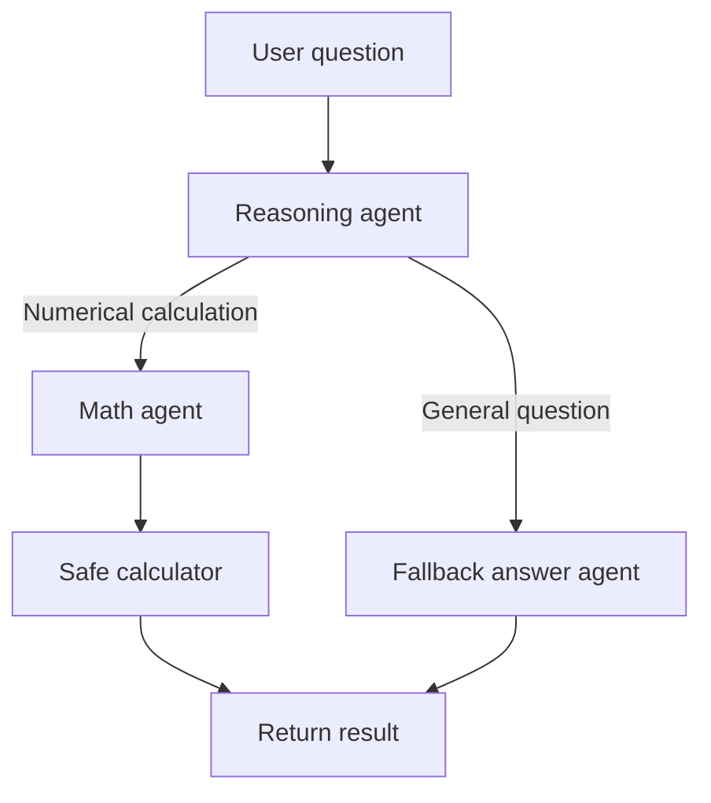

# Agentic Design Patterns

A small LangGraph application that routes user requests through a math tool or a general-purpose answer path. The Streamlit interface supports both kinds of questions in one conversation.

## Workflow



The reasoning agent classifies each request and prepares an arithmetic expression when needed. Arithmetic expressions are evaluated using a restricted AST interpreter; Python functions and other code are not accepted. Requests such as definitions and explanations are sent to the fallback answer agent instead.

## Setup

From the repository root, create and activate a virtual environment, then install dependencies:

```bat
py -m venv venv
venv\Scripts\activate
python -m pip install -r requirements.txt
```

Create a `.env` file in the repository root. The API key must be a valid OpenAI API key; never commit `.env` or share its contents.

```dotenv
OPENAI_API_KEY=your-new-api-key
OPENAI_MODEL=gpt-4o-mini
```

`OPENAI_MODEL` is optional and defaults to `gpt-4o-mini`. If an API key was exposed, revoke it and create a replacement before running the app.

## Run

Launch the Streamlit chat UI from the repository root:

```bat
streamlit run app.py
```

You can also run the sample graph invocation without the UI:

```bat
python -m patterns.using_tools.run
```

## Tests

Run the focused unit tests with:

```bat
python -m unittest discover -s tests
```
